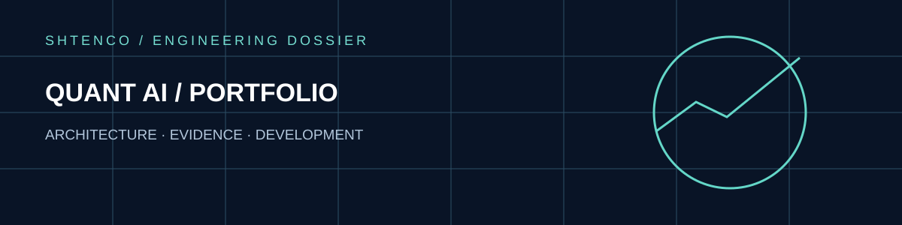

**Single-file bilingual responsive Quant-AI portfolio; interactive visual narrative**

# SHTENCO QUANT / INVESTOR PRESENTATION

## Original research direction

The index contains RU/EN content switching, responsive CSS, navigation, animated canvas, technology descriptions, investment narrative and contact sections. It is a web presentation surface that makes a complex R&D portfolio legible to investors and engineering collaborators.

## Implemented engineering and algorithmic value

Published financial targets and capacity metrics are editorial claims, not evidence of audited financial performance. They should reference a source and the date at which the measurement was taken.

## Scientific and mathematical interpretation

Add source-linked project catalogue, accessibility testing, RU/EN parity, mobile visual regression, publication-dated claim manifest and demos anchored to actual repository commits.

## Research and application opportunities

undefined

## Evidence context and development maturity

A disclosed illustrative investment scenario should always identify horizon, starting capital, costs and whether a rate is expected, simulated or realized. In particular compounded capital follows C_n=C_0*(1+r)^n only for constant periodic net rate r; no such return is established here.

## Source navigation

- [`index.html`](index.html)

## Publication protocol

Claims must refer to the exact current source commit or an identified experiment artifact. Source code establishes implementation; experiments require frozen inputs, complete costs, successful repeated checks and a labelled evaluation regime. Financial values are attributed to their measurement environment. This page is a scientifically grounded overview and is not an offer of investment returns.
